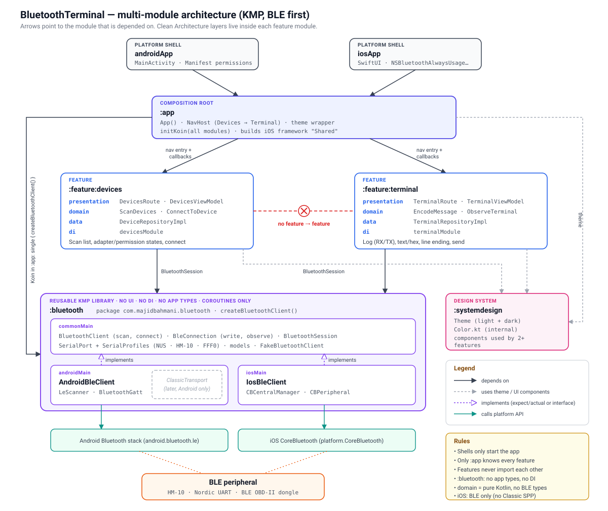

# BluetoothTerminal

A Bluetooth terminal for Android and iOS (Kotlin Multiplatform + Compose Multiplatform): scan for
devices, connect, and send and receive data. BLE first on both platforms; Bluetooth Classic (SPP)
is planned for Android only, because iOS has no public API for it.

## Features

| | Android | iOS |
|---|---|---|
| Bluetooth availability, permission request, "turn on Bluetooth" | ✅ | placeholder |
| Scan for BLE devices, stop / scan again | ✅ | placeholder |
| Connect, connection status (connecting, failed, lost), disconnect | ✅ | placeholder |
| Terminal: send text, see sent and received messages | ✅ | placeholder |
| Serial profile detection (Nordic UART, HM-10, FFF0, Microchip) | ✅ | placeholder |
| Settings: services and characteristics, choose where to send and what to listen to, read a value | ✅ | placeholder |

iOS builds and shows "Bluetooth not supported" until the CoreBluetooth implementation of the library lands.

## Architecture



### Modules

| Module | Role | Depends on |
|---|---|---|
| `androidApp` / `iosApp` | Platform shells: `MainActivity` + `Application` (starts Koin) / SwiftUI entry point | `:app` |
| `:app` | Composition root: `App()` (theme, `NavHost`), Koin setup (`initKoin`, app scope, `BluetoothSession`, platform `BluetoothClient`), iOS framework | everything |
| `:feature:terminal` | One feature for one user goal (connect and talk): Devices, Terminal and Settings screens | `:bluetooth`, `:systemdesign` |
| `:bluetooth` | Reusable KMP BLE library: no UI, no DI, no app types; only coroutines | — |
| `:systemdesign` | Shared theme (planned, empty for now) | — |

Modules are cut per **feature**, not per screen. Independent features (e.g. macros, history) will get
their own modules.

### Layers inside `:feature:terminal`

One package per screen, each with its own Clean Architecture layers, plus a shared `connection/`
package. Screen packages never import each other.

| Package | presentation | domain | data |
|---|---|---|---|
| `connection/` (shared) | — | `ConnectionStatus`, channel models, `ConnectionRepository`, `ChannelRepository`, `ObserveConnection`, `Disconnect` | `ConnectionRepositoryImpl`, `ChannelRepositoryImpl` |
| `devices/` | `DevicesScreen`, `DevicesViewModel`, `BluetoothActions` (expect/actual) | `Device`, `DeviceScan`, `DeviceRepository`, `ScanDevices`, `ConnectToDevice` | `DeviceRepositoryImpl` |
| `terminal/` | `TerminalScreen`, `TerminalViewModel` | `TerminalMessage`, `ObserveMessages`, `SendMessage` | — (uses `ChannelRepository`) |
| `settings/` | `SettingsScreen`, `SettingsViewModel` | `ServiceSettings`, `ObserveServiceSettings`, `SetSendTarget`, `SetListening`, `ReadCharacteristic` | — (uses `ChannelRepository`) |

- **presentation** depends on **domain** (use cases) only; **domain** is pure Kotlin with no `:bluetooth`
  types; only **data** uses the library.
- Each package has its own `internal` Koin module (`di/`). The feature exposes two public entry points:
  `terminalScreens()` (`navigation/`) and `terminalFeatureModule` (`di/`), which includes the package modules.

### Inside `:bluetooth`

| Source set | Contents |
|---|---|
| `commonMain` | `BluetoothClient` (adapter: state, scan, connect), `BleConnection` (one link: read, write, observe), `BluetoothSession` (holds the current link: Idle, Connecting, Connected, Failed, Lost), `model/`, `serial/` (`SerialProfiles`, `writeChunked`), `testing/` (fakes for other modules' tests) |
| `androidMain` | `AndroidBleClient`, `AndroidBleConnection` (`BluetoothGatt`), `GattQueue` (one GATT operation at a time) |
| `iosMain` | Placeholder client reporting `Unsupported`; CoreBluetooth implementation planned |

## Project structure

```
androidApp/          Android shell (MainActivity, Application)
iosApp/              iOS shell (Xcode project, SwiftUI)
app/                 composition root (App.kt, di/)
feature/terminal/    connection/, devices/, terminal/, settings/, navigation/, di/
bluetooth/           BLE library (commonMain, androidMain, iosMain)
systemdesign/        theme (planned)
art/                 README images
```

## Running the apps

- Android: `./gradlew :androidApp:installDebug` (a real phone: the emulator has no BLE devices nearby)
- iOS: open [/iosApp](./iosApp) in Xcode and run it

Minimum Android version: 12 (API 31), so only `BLUETOOTH_SCAN` / `BLUETOOTH_CONNECT` are needed (no location).

## Running tests

```bash
./gradlew :bluetooth:testAndroidHostTest :feature:terminal:testAndroidHostTest :app:testAndroidHostTest
./gradlew :bluetooth:iosSimulatorArm64Test :feature:terminal:iosSimulatorArm64Test :app:iosSimulatorArm64Test
```

Tests use fakes, no hardware: `FakeBluetoothClient` / `FakeBleConnection` from `:bluetooth`, fake
repositories in the feature.

---

Learn more about [Kotlin Multiplatform](https://www.jetbrains.com/help/kotlin-multiplatform-dev/get-started.html)…
### Releasing the Android app

1. Create an upload key once (keep the file and passwords safe, outside git; an absolute
   `storeFile` path lets the keystore live outside the repo):
   `keytool -genkeypair -v -keystore keystore/upload-keystore.jks -alias upload -keyalg RSA -keysize 2048 -validity 10000`
2. Copy `keystore.properties.example` to `keystore.properties` and fill in the passwords.
   On CI, set `ANDROID_KEYSTORE_FILE`, `ANDROID_KEYSTORE_PASSWORD`, `ANDROID_KEY_ALIAS` and `ANDROID_KEY_PASSWORD` instead.
3. Build the bundle for Google Play: `./gradlew :androidApp:bundleRelease`
   (output: `androidApp/build/outputs/bundle/release/androidApp-release.aab`).
